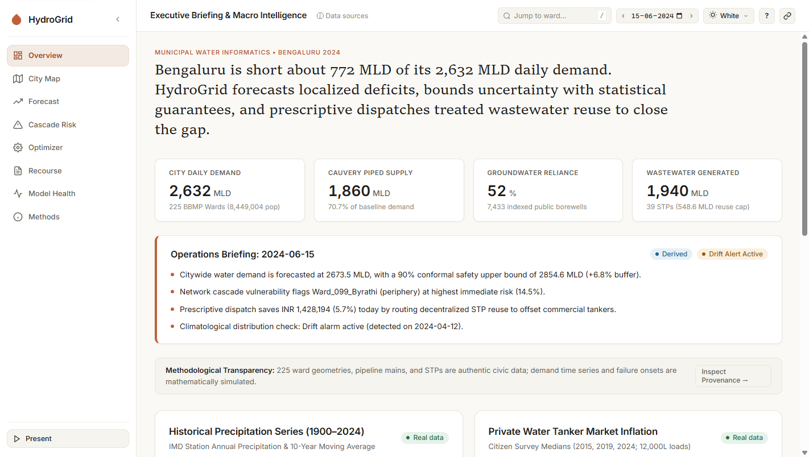
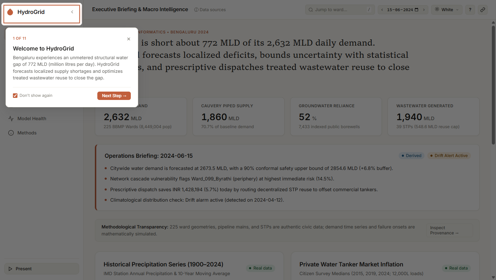
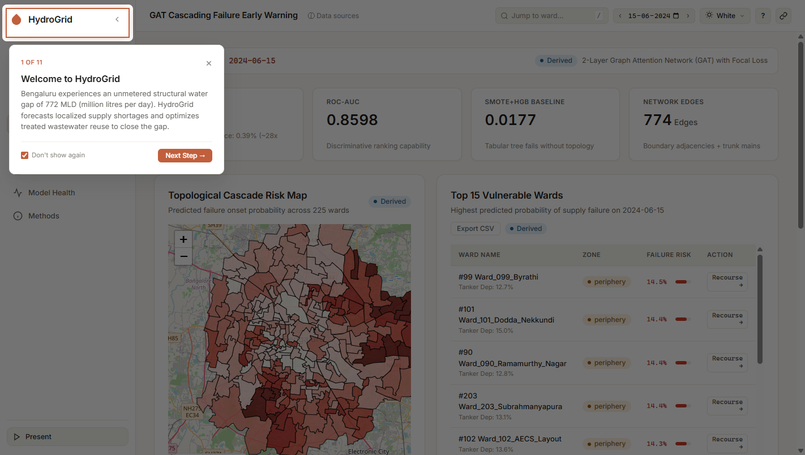

# HydroGrid

A municipal water intelligence, conformal uncertainty forecasting, cascading failure early warning, and prescriptive wastewater reuse optimization platform for Bengaluru.

[](https://www.python.org/)
[](https://fastapi.tiangolo.com/)
[](https://pytorch.org/)
[](https://leafletjs.com/)
[](LICENSE)

---

## Screenshots

| Executive Briefing & Macro Intelligence | Civic Infrastructure & Spatial Layers |
| :---: | :---: |
|  |  |

| Cascading Failure Early Warning (GAT) |
| :---: |
|  |

---

## Overview

Bengaluru's municipal water demand stands at approximately 2,632 MLD (Million Litres per Day), while piped surface supply from the Cauvery River provides only 1,860 MLD, leaving a 772 MLD structural deficit bridged by over-extracted groundwater and private water tankers whose spot rates have escalated significantly. HydroGrid models the city's transmission grid across all 225 administrative wards to forecast daily water demand with statistically rigorous uncertainty bounds, identify spatial cascade failure risks before shortages spread, and prescriptively route treated wastewater to reduce tanker reliance. The application couples authentic civic geographic information system (GIS) boundary layers, pipeline maps, and sewage treatment plant (STP) registries with open-source machine learning and mathematical optimization in a production-ready web dashboard.

## Table of Contents

- [Key Results](#key-results)
- [Features](#features)
- [How It Works](#how-it-works)
- [Data and Transparency](#data-and-transparency)
- [Tech Stack](#tech-stack)
- [Project Structure](#project-structure)
- [Getting Started](#getting-started)
- [API Reference](#api-reference)
- [Dashboard Walkthrough](#dashboard-walkthrough)
- [Reproducibility](#reproducibility)
- [Limitations and Future Work](#limitations-and-future-work)
- [Troubleshooting](#troubleshooting)
- [Author and License](#author-and-license)

---

## Key Results

All evaluation metrics are computed on the held-out 2024 test year (247,050 samples: 225 wards &times; 366 days &times; 3 horizons) and loaded directly from [`results/metrics.json`](results/metrics.json).

| Pipeline Stage | Model / Method | Metric | Evaluation Result |
| :--- | :--- | :--- | :--- |
| **Demand Forecasting** | Naive (Persistence) | Overall MAE / RMSE | 0.621 MLD / 0.838 MLD |
| | Seasonal Naive (7-Day) | Overall MAE / RMSE | 0.690 MLD / 1.002 MLD |
| | STGCN (ChebConv + GRU) | Overall MAE / RMSE | 0.537 MLD / 0.793 MLD |
| | **HistGradientBoosting (Best)** | Overall MAE / RMSE | **0.451 MLD** / **0.639 MLD** |
| | HistGradientBoosting ($h=1, 2, 3$) | MAE by Horizon | 0.411 / 0.456 / 0.486 MLD |
| | HistGradientBoosting (By Zone) | MAE Core / Mid / Periphery | 0.391 / 0.408 / 0.528 MLD |
| **Uncertainty Quantification** | Static Split Conformal | Marginal Coverage / Mean Width | 85.7% / 1.582 MLD |
| | **Adaptive Conformal (ACI, $\gamma=0.01$)** | Marginal Coverage / Mean Width | **89.1%** (90% target) / 1.614 MLD |
| **Cascade Risk Early Warning** | Tabular Baseline (HGB + SMOTE) | PR-AUC / ROC-AUC / F1 | 0.0177 / 0.7617 / 0.0456 |
| | Trivial Adjacency Heuristic | PR-AUC / ROC-AUC / F1 | 0.0276 / 0.8150 / 0.0612 |
| | **GAT (Graph Attention + Focal Loss)** | PR-AUC / ROC-AUC / F1 | **0.1098** (28&times; over 0.39% prevalence) / **0.8598** / **0.2191** |
| **Prescriptive Dispatch** | HiGHS Mixed-Integer Linear Program | Solve Time / Daily Net Savings | **0.502s** / **&#8377;1,428,235** (5.68% reduction) |
| | Conformal vs Point Strategy | Realized Unmet Shortfall | **4.60 MLD** vs 33.50 MLD (86.3% risk reduction) |
| **Counterfactual Recourse** | DiCE Actionable Interventions | Validity Rate / Proximity | **100.0%** / 0.3851 |
| **Model Health & Drift** | 1D Wasserstein Distance Monitor | First Alarm Date / Retrain Fit | **2024-04-12** (summer heatwave) / 0.165s incremental |

---

## Features

- **Executive Overview**: Citywide daily demand, Cauvery piped supply, groundwater reliance, and operational briefings bounded by 90% conformal safety guarantees.
- **Civic Infrastructure Map**: Interactive Leaflet GIS visualization featuring 225 administrative ward polygons, 5 dynamic data choropleths, 5,186 trunk main segments (>300mm), 39 operational sewage treatment plants (STPs), and 2024 temporal playback.
- **Demand Forecast**: Ward-level multi-horizon time series with adaptive conformal inference (ACI) prediction bands, model architecture comparison tables, and PNG chart exports.
- **Cascade Risk**: Graph Attention Network (GAT) early warning predicting localized pipe and tanker failure propagation 24&ndash;48 hours in advance, paired with an interactive Top 15 Vulnerable Wards table and CSV export.
- **Prescriptive Optimizer**: Multi-period Mixed-Integer Linear Programming (MILP) dispatch routing 548.6 MLD of decentralized treated wastewater reuse to displace commercial water tanker expenditure.
- **Actionable Recourse**: Counterfactual optimization (DiCE) computing minimal feasible interventions (e.g., rainwater harvesting, piped supply quotas) under conformal safety constraints.
- **Model Health & Drift**: Continuous monitoring of climatological and feature distribution shifts using 1D Wasserstein distances, automated retrain alarms, and continual learning benchmarks.
- **Methodology & Provenance**: Full civic inventory disclosing which layers are authentic public records and which components are simulated.
- **Interactive Usability**: Built-in 11-step offline guided tour, persistent light/dark/system theme toggle, keyboard shortcuts (`?`, `G` chords, `/` ward search), and full-screen Present mode.

---

## How It Works

```mermaid
flowchart TD
    A["Civic Datasets & IMD Climate<br/>(225 BBMP Wards, 7,433 Borewells, 39 STPs)"] --> B["Graph Topology (src/u1_geo.py)<br/>(774 Edges: Boundaries + Trunk Mains)"]
    B --> C["Calibrated Spatial Simulator (src/p1_graph_sim.py)<br/>(411,075 Ward-Day Observations, 2020-2024)"]
    C --> D["Multi-Horizon Forecasters (src/p2_baselines.py, src/p3_stgcn.py)<br/>(HistGradientBoosting vs STGCN)"]
    D --> E["Conformal Uncertainty (src/p4_conformal.py)<br/>(Adaptive Conformal Inference ACI: 89.1% Coverage)"]
    B --> F["Cascade Risk GAT (src/p5_cascade.py)<br/>(Graph Attention with Focal Loss)"]
    E --> G["Prescriptive MILP Optimizer (src/p6_optimize.py)<br/>(HiGHS Solver: &#8377;1.43M/day Savings)"]
    E --> H["Actionable Recourse (src/p7_recourse.py)<br/>(DiCE Counterfactual Interventions)"]
    C --> I["Drift Safeguard (src/p8_drift.py)<br/>(1D Wasserstein Distance Alarms)"]
    G --> J["FastAPI Backend (app/main.py)<br/>(21 REST Endpoints, GZip, In-Memory Caching)"]
    H --> J
    I --> J
    F --> J
    J --> K["Responsive UI (app/static/)<br/>(Vanilla ES Modules, Leaflet, Plotly)"]
```



| Pipeline Stage | Module File | Core Mechanism | Output Artifact |
| :--- | :--- | :--- | :--- |
| **Civic Topology** | [`src/u1_geo.py`](src/u1_geo.py) | KML parsing, boundary adjacency, STRtree spatial joins | [`data/wards.csv`](data/wards.csv), [`data/edges.csv`](data/edges.csv), [`data/geo/`](data/geo/) |
| **Spatial Simulation** | [`src/p1_graph_sim.py`](src/p1_graph_sim.py) | Spatial AR(1) thermal scaling, drought amplification | [`data/simulated_demand.csv`](data/simulated_demand.csv), [`data/weather_daily.csv`](data/weather_daily.csv) |
| **Tabular Forecast** | [`src/p2_baselines.py`](src/p2_baselines.py) | HistGradientBoostingRegressor with cyclical & lag features | [`models/hgb.pkl`](models/hgb.pkl), [`data/preds_hgb.csv`](data/preds_hgb.csv) |
| **Graph Forecast** | [`src/p3_stgcn.py`](src/p3_stgcn.py) | ChebConv spatial graph convolutions + GRU temporal cells | [`models/stgcn.pt`](models/stgcn.pt), [`data/preds_stgcn.csv`](data/preds_stgcn.csv) |
| **Conformal Prediction** | [`src/p4_conformal.py`](src/p4_conformal.py) | Non-conformity calibration and rolling step-size adaptation ($\gamma=0.01$) | [`results/metrics.json`](results/metrics.json) |
| **Cascading Risk** | [`src/p5_cascade.py`](src/p5_cascade.py) | 2-layer Graph Attention Network with Focal Loss ($\gamma=2.0$) | [`models/gat.pt`](models/gat.pt), [`data/cascade_risk.csv`](data/cascade_risk.csv) |
| **Prescriptive Dispatch** | [`src/p6_optimize.py`](src/p6_optimize.py) | Multi-period mixed-integer linear programming (MILP via HiGHS) | [`data/demo_cache.json`](data/demo_cache.json) |
| **Counterfactual Recourse** | [`src/p7_recourse.py`](src/p7_recourse.py) | Nearest-neighbor genetic counterfactual search | [`models/recourse_clf.pkl`](models/recourse_clf.pkl) |
| **Distribution Drift** | [`src/p8_drift.py`](src/p8_drift.py) | 1D Wasserstein distance tracking with retrain benchmarks | [`data/drift.csv`](data/drift.csv) |
| **Web Application** | [`app/main.py`](app/main.py) | Asynchronous FastAPI REST routing and static file serving | Web app on port 8000 |

---

## Data and Transparency

HydroGrid enforces strict methodological transparency regarding data authenticity:

| Data Layer | Source Authority | Provenance Status | Description |
| :--- | :--- | :--- | :--- |
| **Ward Delimitations (225)** | BBMP GIS Portal (2023) | **Authentic Civic GIS** | Exact municipal polygons, areas, and centroid coordinates |
| **Transmission Trunk Mains** | BWSSB Geographic Data | **Authentic Civic GIS** | 5,186 mapped water lines with diameters $\ge 300\text{ mm}$ |
| **Sewage Treatment Plants** | BWSSB Operations Directory | **Authentic Civic GIS** | 39 treatment facilities with 548.6 MLD total secondary reuse capacity |
| **Groundwater Wells** | Department of Mines & Geology | **Authentic Civic GIS** | 7,433 indexed public borewells and monitoring point depths |
| **Meteorological Records** | India Meteorological Department | **Authentic Civic Records** | 73 years (1951&ndash;2024) of daily rainfall and temperature observations |
| **Daily Water Demand** | HydroGrid Simulator v2 | *Synthesized Proxy* | Calibrated synthetic series (2,632 MLD city mean) scaled to Census populations |
| **Pipe Failure Outages** | Stochastic Network Model | *Synthesized Proxy* | Synthetic cascade onset events (0.39% prevalence) for early warning training |

> Raw KML and CSV files originally located in `new_dataset/` (from OpenCity.in, BBMP, and BWSSB public portals) are preprocessed into standardized artifacts inside `data/` and `data/geo/`. The raw `new_dataset/` directory is omitted from source versioning to conserve repository footprint.

---

## Tech Stack

- **Backend**: Python 3.12, FastAPI, Uvicorn, Pydantic, GZip Middleware.
- **Machine Learning & Uncertainty**: PyTorch, PyTorch Geometric, Scikit-Learn, SciPy.
- **Mathematical Optimization**: Pyomo, HiGHS Solver (via `highspy`).
- **Geospatial Processing**: Shapely 2.0+, GeoJSON.
- **Frontend**: Vanilla ES6+ JavaScript modules, HTML5, CSS Variables, Leaflet 1.9.4, Plotly.js Cartesian.

---

## Project Structure

```text
hydrogrid/
├── app/                        # Web application
│   ├── main.py                 # FastAPI backend, routing, in-memory caches
│   └── static/                 # Frontend assets (no build step required)
│       ├── index.html          # HTML5 application shell and modal dialogs
│       ├── css/                # Design tokens, components, and responsive stylesheets
│       └── js/                 # ES modules: router, map layers, charts, tour, palette
├── data/                       # Preprocessed tabular data and GeoJSON layers
│   ├── geo/                    # wards.geojson, trunk_mains.geojson, stps.geojson
│   ├── demo_cache.json         # Instant scenario presets for zero-latency evaluations
│   ├── split_dates.json        # Train (2020-2022), Cal (2023), Test (2024) splits
│   └── wards.csv               # 225 BBMP wards master attribute table
├── docs/                       # Hero screenshots and architectural figures
├── models/                     # Serialized model weights (HGB, STGCN, GAT, Recourse)
├── notebooks/                  # Step-by-step exploratory Jupyter notebooks (00 to 05)
├── results/                    # Validation summaries, metrics.json, and PROGRESS.md
├── src/                        # Core algorithmic pipeline modules (p0 to p8, u1 to u7)
│   ├── config.py               # Central paths, geographic constants, and seeds
│   └── run_all.py              # Single-command pipeline reproduction orchestrator
├── LICENSE                     # MIT Open Source License
├── requirements.txt            # Frozen dependency manifest
└── README.md                   # Project landing documentation
```

---

## Getting Started

### Prerequisites

- Python 3.12 installed on your system.
- Git.

### 1. Clone and Environment Setup

**Windows PowerShell:**
```powershell
git clone https://github.com/[YOUR NAME]/hydrogrid.git
cd hydrogrid
python -m venv venv
.\venv\Scripts\Activate.ps1
python -m pip install --upgrade pip
pip install -r requirements.txt
```

**macOS / Linux:**
```bash
git clone https://github.com/[YOUR NAME]/hydrogrid.git
cd hydrogrid
python3.12 -m venv venv
source venv/bin/activate
python -m pip install --upgrade pip
pip install -r requirements.txt
```

### 2. Run the Dashboard

Start the application server:
```bash
uvicorn app.main:app --host 127.0.0.1 --port 8000
```
Open [http://127.0.0.1:8000](http://127.0.0.1:8000) in your web browser.

Verify the server is healthy:
```bash
curl http://127.0.0.1:8000/api/health
```
Expected response:
```json
{"status": "healthy", "n_wards": 225, "version": "2.0.0"}
```

### 3. Optional: Re-run Full Training Pipeline

To re-run the entire pipeline from scratch (feature extraction, model training, conformal calibration, and optimization precomputations):
```bash
python src/run_all.py
```

---

## API Reference

| Method | Endpoint | Description |
| :--- | :--- | :--- |
| `GET` | `/api/health` | Service health status, total ward count (225), and API version. |
| `GET` | `/api/geo/wards` | GeoJSON polygons and civic metadata for all 225 BBMP wards. |
| `GET` | `/api/geo/pipes` | GeoJSON LineStrings for civic transmission trunk mains ($\ge 300\text{ mm}$). |
| `GET` | `/api/geo/stps` | GeoJSON Points and capacity ratings for 39 sewage treatment facilities. |
| `GET` | `/api/geo/borewells` | GeoJSON Points for a representative spatial sample of 2,500 borewells. |
| `GET` | `/api/geo/{layer}` | Generic geo-layer dispatch router (`wards`, `pipes`, `stps`, `borewells`). |
| `GET` | `/api/overview` | Macroscopic supply-demand balance, Cauvery piped flow, and groundwater metrics. |
| `GET` | `/api/provenance` | Complete dataset inventory identifying authentic vs. synthesized components. |
| `GET` | `/api/search?q={query}` | Autocomplete search across ward names, IDs, and zones. |
| `GET` | `/api/briefing?date={YYYY-MM-DD}` | Daily municipal briefing including 90% conformal safety buffer. |
| `GET` | `/api/v1compare` | Comparison table contrasting HydroGrid against legacy heuristic baselines. |
| `GET` | `/api/presets` | Pre-solved scenario dispatch presets (`normal`, `summer`, `drought`). |
| `GET` | `/api/wards` | Array of 225 wards with baseline demand, population, and zone attributes. |
| `GET` | `/api/dates` | List of available simulation and evaluation dates across 2024. |
| `GET` | `/api/forecast?ward_id={id}&h={1\|2\|3}` | Multi-horizon demand forecast with adaptive conformal prediction bands. |
| `GET` | `/api/map?date={date}&layer={layer}` | Ward choropleth values for active spatial layer on selected date. |
| `GET` | `/api/risk?date={date}` | Citywide GAT failure onset probabilities and Top 15 Vulnerable Wards. |
| `POST` | `/api/optimize` | Solves the HiGHS MILP wastewater reuse dispatch model for custom inputs. |
| `GET` | `/api/recourse?ward_id={id}&date={date}` | Actionable DiCE counterfactual remediation packages for a ward. |
| `GET` | `/api/drift` | 1D Wasserstein distance time series, baseline thresholds, and retrain results. |
| `GET` | `/api/methods` | Comprehensive scientific documentation and benchmark audit logs. |

---

## Dashboard Walkthrough

1. **Automatic Guided Tour**: When visiting the application for the first time, an 11-step interactive tour automatically launches, spotlighting the core interface elements. The tour can be replayed at any time via the top toolbar (**Help (?) &rarr; Take the tour**).
2. **Navigating Views**: Use the sidebar or press `G` followed by a navigation shortcut key:
   - `G` then `O`: Executive Overview (`#/overview`)
   - `G` then `M`: Civic Infrastructure Map (`#/map`)
   - `G` then `F`: Demand Forecasting (`#/forecast`)
   - `G` then `R`: Cascade Risk Early Warning (`#/risk`)
   - `G` then `P`: Prescriptive Optimizer (`#/optimizer`)
   - `G` then `C`: Actionable Recourse (`#/recourse`)
   - `G` then `H`: Model Health & Drift (`#/health`)
   - `G` then `T`: Methodology & Provenance (`#/methods`)
3. **Command Palette & Search**: Press `/` or `Ctrl+K` from any view to search and jump directly to any of the 225 wards.
4. **Theme Customization**: Toggle between Light, Dark, or System mode from the top-right toolbar or by pressing `T`.

---

## Reproducibility

The end-to-end experimental workflow is strictly reproducible across systems:

- **Random Seed**: Fixed globally to `42` across Python, NumPy, and PyTorch ([`src/config.py`](src/config.py)).
- **Temporal Data Splits** ([`data/split_dates.json`](data/split_dates.json)):
  - **Training Split**: 2020-01-01 to 2022-12-31 (1,096 days)
  - **Calibration Split**: 2023-01-01 to 2023-12-31 (365 days)
  - **Test Evaluation Split**: 2024-01-01 to 2024-12-31 (366 days, leap year)
- **Interactive Notebooks**:
  1. [`notebooks/00_env_check.ipynb`](notebooks/00_env_check.ipynb): Verifies Python 3.12, PyTorch, Pyomo, and HiGHS solver binaries.
  2. [`notebooks/01_explore.ipynb`](notebooks/01_explore.ipynb): Spatial exploration of BBMP ward boundaries and groundwater depths.
  3. [`notebooks/02_load_data.ipynb`](notebooks/02_load_data.ipynb): Parses KML civic layers into GeoDataFrames.
  4. [`notebooks/03_graph.ipynb`](notebooks/03_graph.ipynb): Constructs the 774-edge transmission network graph.
  5. [`notebooks/04_simulate.ipynb`](notebooks/04_simulate.ipynb): Validates spatial AR(1) demand and failure onset dynamics.
  6. [`notebooks/05_baseline.ipynb`](notebooks/05_baseline.ipynb): Evaluates persistence, seasonal, HGB, and STGCN forecasting models.

---

## Limitations and Future Work

- **Simulated Demand Series**: While municipal ward boundaries, pipelines, STPs, and IMD weather observations are authentic, ward-level volumetric water consumption is synthetically generated because real-time smart meter telemetry is not publicly released by civic authorities.
- **Extreme Failure Imbalance (0.39% Prevalence)**: While GAT achieves a 28&times; enrichment over random baseline (0.1098 PR-AUC vs 0.0039), absolute precision remains modest due to the acute class imbalance inherent in municipal infrastructure failures.
- **Static Hydraulic Assumptions**: Pipeline flow connectivity is modeled through graph edges with distance-decay friction penalties rather than dynamic EPANET hydrodynamic head-loss simulations.
- **Single-City Scope**: Topography and parameters are specifically calibrated to Bengaluru's high-altitude plateau and Cauvery Stage I&ndash;IV pipeline layout.

---

## Troubleshooting

- **Port 8000 Already in Use (Windows PowerShell)**:
  ```powershell
  $pids = (Get-NetTCPConnection -LocalPort 8000 -ErrorAction SilentlyContinue).OwningProcess | Select-Object -Unique
  foreach ($p in $pids) { Stop-Process -Id $p -Force -ErrorAction SilentlyContinue }
  ```
- **PowerShell Script Execution Policy Error**:
  If `Activate.ps1` is blocked, run:
  ```powershell
  Set-ExecutionPolicy -ExecutionPolicy RemoteSigned -Scope CurrentUser
  ```
- **Map Tiles Showing Dark Filter in Light Mode**:
  Toggle the theme dropdown in the top toolbar to **White** or clear localStorage via `localStorage.clear()` in the browser developer console.
- **Missing Pretrained Models**:
  If `.pkl` or `.pt` files are absent in `models/`, regenerate the complete pipeline by running:
  ```bash
  python src/run_all.py
  ```

---
